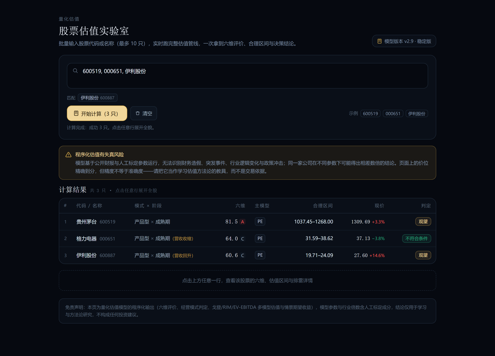
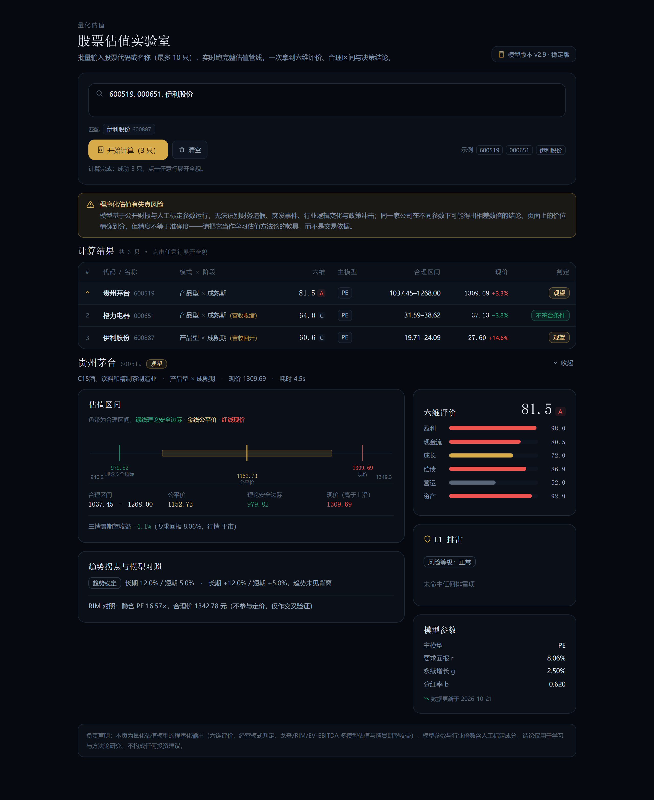

# 估值助手 · A股企业评价与估值（本地版）

**模型版本 v2.9 · 稳定版**

一只股票到底值多少钱？这个程序用一套固定规则算给你看，而不是靠感觉。

输入一组代码或名称，逐只算：先排雷（有没有财务风险），再打分（六个维度），
然后判断它处在什么经营阶段、该用什么模型估值，最后给出合理价格区间和操作结论。

所有计算都在你自己的电脑上完成，不上传任何数据，也不需要注册账号。

---

## 界面预览






---

## 怎么用

1. 双击 **`估值助手.exe`**
2. 会弹出一个黑色窗口，同时浏览器自动打开界面
3. 在输入框里填一组股票，**逗号或空格分隔，最多 10 只**：
   `600519, 000651, 伊利股份`
   代码、中文名、拼音首字母（gzmt）都认，输入时下方会出现匹配候选，点一下即可填入
4. 点「开始计算」，每只约 3–6 秒，算完一只立即出现在表格里
5. **点表格任意一行**，下方展开这只股票的完整详情（估值区间标尺、六维、排雷、模型参数）

**关闭那个黑色窗口 = 退出程序。** 窗口关掉后浏览器里的页面也就不能用了，这是正常的。

> 第一次运行 Windows 可能提示「已保护你的电脑」（因为 exe 没有数字签名）。
> 点「更多信息」→「仍要运行」即可。程序不联网上传数据，源码全部公开在本仓库中。

---

## 结果怎么看

### 一、排雷

先看有没有一票否决的问题：

| 等级 | 含义 |
|---|---|
| **不通过** | 命中硬否决（ST、利润反复腰斩、实控人大额质押等），直接排除，不算价格 |
| **高危** | 减分项 ≥3 条，能算但不建议碰 |
| **关注** | 有 1–2 个要留意的点 |
| **正常** | 没发现明显问题 |

减分项每一条都写了具体数字和原因，比如「应收增速 +31.3%，营收 −4.8%，
增速差 36.1pp」——不是模糊的形容词。

### 二、六维评分

盈利、现金流、成长、偿债、营运、资产质量六个维度，各按行业同业分位打分，
再加权成总分（A ≥80 / B ≥70 / C ≥50 / D <50）。

**分数高只代表公司好，不代表现在值得买** —— 好公司买贵了一样亏钱，所以还要看第三步。

### 三、估值与决策

点开某一行的详情后，会看到一条**估值区间标尺**：

- 金色色带 = 合理区间
- 金线 = 公平价（算出来的中枢）
- 绿线 = 理论安全边际（打折后值得出手的位置）
- 红线 = 现价

三个价位的相对位置一眼就能看出贵还是便宜。下方还有：

| 指标 | 含义 |
|---|---|
| 合理区间 | 按这个公司的赚钱能力、成长性、风险算出来的价值范围 |
| 理论安全边际 | 在合理价基础上再打折扣的价格，到这个位置才算「有便宜可占」 |
| 三情景期望收益 | 按当前价买入、未来回到合理价能拿到的年化回报 |
| 结论 | 计算合理 / 接近合理 / 观望 / 不符合条件 / 回避 / 淘汰 |

**「观望」不代表公司不好，只是现在的价格已经把好处提前透支了。**

---

## 系统要求

- Windows 10 / 11（64 位）
- 能上网（行情、财报数据要实时取）
- 不需要装 Python，不需要装任何运行库

---

## 常见问题

**Q：为什么算一只要十几秒？**
要拉实时行情、五年财报、三张报表、同业几十家公司做对比，十几个网络请求。
算过的股票 10 分钟内再查是秒出的。

**Q：数据从哪来？**
腾讯行情（价格、市值）、东方财富（财务指标、股东质押、解禁）、新浪财经（三大报表）。
全部是公开免费接口。

**Q：能离线用吗？**
不能。每次都要取最新数据。

**Q：结果能直接照着买吗？**
不能。这是一套**规则化的研究辅助工具**，帮你看清风险和大致价值区间，
但它不知道行业突发变化、政策转向、管理层变动。程序化估值天然有失真风险，
结论只作参考，决策和后果都在你自己。

**Q：黑色窗口能隐藏吗？**
它是程序本体，关掉就退出。最小化不影响使用。

**Q：能不能算港股/美股？**
只支持 A 股（沪、深、京）。

---

## 给开发者

源码就在这个目录里，零第三方依赖，只需要 Python 3.10+：

```bash
python app.py              # 起本地服务并自动开浏览器
python app.py --no-browser # 只起服务
python app.py --port 9000  # 换端口
```

命令行批量跑（不经过网页）：

```bash
set PYTHONPATH=src
python -m stock_value_estimator.main 600519 000858 --json out/
```

重新打包 exe：

```bash
build.bat
```

估值规则、参数含义、每条判据的实测依据，见 `src/stock_value_estimator/`
里各模块的文档字符串，以及原项目的设计文档。

参数都在 `src/stock_value_estimator/config/*.json`，改完直接生效，不用改代码。

数据文件 `data/stock_industry_map.json`（5187 只股票 → 证监会行业）**不能删**：
六维评分要用它做同业分位，缺了会让行业标签变空、同业样本归零，
连带经营模式退回默认的「运营型」、总分虚高。打包时由 `build.spec` 打进 exe。

---

## 版本

| 版本 | 说明 |
|---|---|
| **v2.9** | **稳定基线**：L1 排雷（H1–H7 硬否决 + S1–S11 减分）、六维评价、经营模式与生命周期判定、戈登/RIM/EV-EBITDA 估值、三情景期望收益、价格四区间。界面形态与金融智库的估值实验室一致。 |
| v3.0 | 规划中（不含在本次打包内） |

本打包为 **v2.9 稳定版**，规则与参数在 `src/stock_value_estimator/config/` 下，
可直接查看或调整，无需修改代码。
